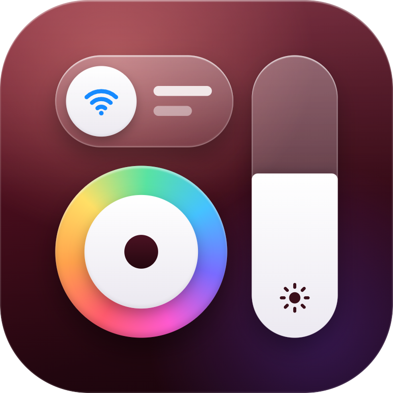
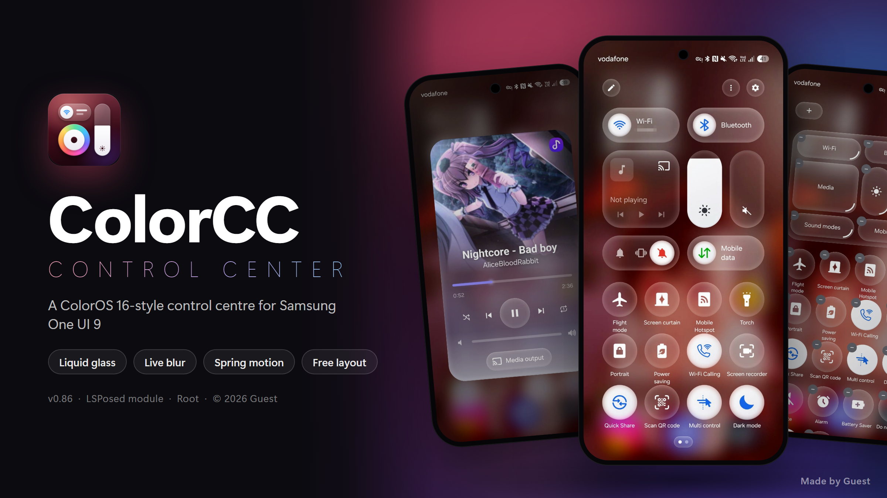
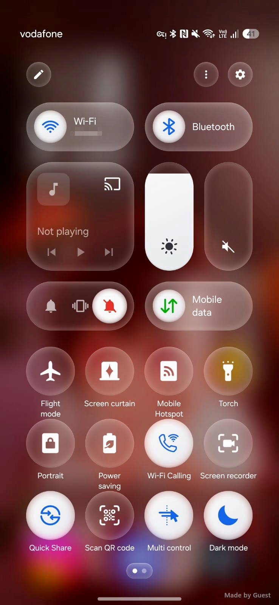
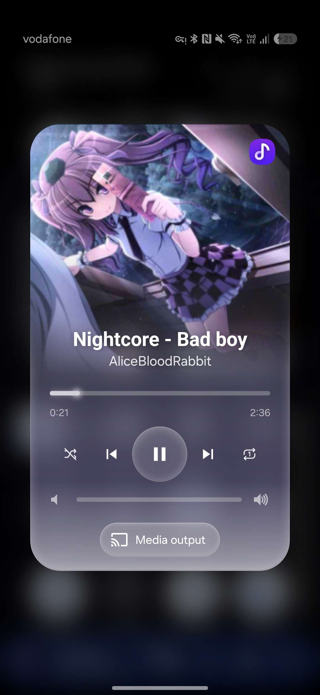
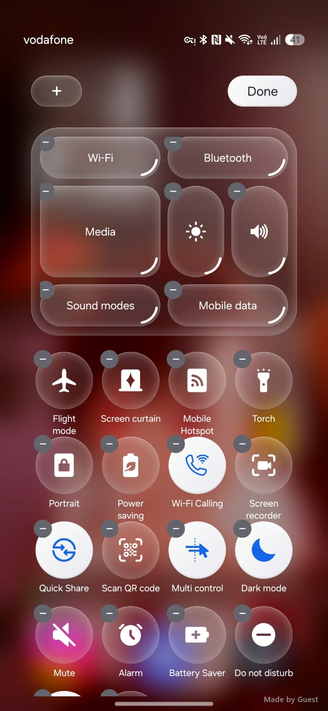

<div align="center">



# ColorCC

**A ColorOS-style control centre for Samsung One UI 9, 8.5 and 8**

Glass surfaces, live blur and spring motion in place of One UI's quick panel, as an LSPosed module.


<br>
<a href="https://t.me/coloredmodules"></a>

<br><br>



</div>

<br>

## Overview

I love the ColorOS control centre and missed it every time I picked up a Samsung phone, so I built ColorCC. You get big glass cards, tall sliders, round tiles and a full media player, all over a live blur of whatever is behind the shade. Every piece moves on its own spring and follows your finger.

ColorCC runs inside System UI as an LSPosed module and changes nothing on disk. Turn the module off and the stock panel is back.

> This repository holds the APK and its docs only. The source is not public.

<br>

## Get leaks before anyone else

I post early looks at upcoming ColorCC updates, and at whatever I build next, in my Telegram channel before they go public.

**[Join @coloredmodules on Telegram](https://t.me/coloredmodules)**

<br>

## Screenshots

<table>
  <tr>
    <td align="center"></td>
    <td align="center"></td>
    <td align="center"></td>
  </tr>
  <tr>
    <td align="center"><b>Control centre</b></td>
    <td align="center"><b>Media player</b></td>
    <td align="center"><b>Editor</b></td>
  </tr>
</table>

<br>

## Features

### Glass
- **Four looks.** Liquid is clear glass that bends the background at its edge. Frosted is milky, with the colours behind glowing through. Opaque is glossy black. None drops the glass for flat shapes, black in dark mode and white in light mode, or always one of the two if you prefer.
- **Tune each look** with sliders for tint, edge shine, edge width, edge glow, frost, colour strength and thickness, over a live preview.
- **Live blur** of whatever is behind the panel, so a video underneath keeps moving through it. Pick Light, Normal, Strong, or set your own strength.
- The glass on cards, tiles and sliders reflects the screen behind it as it changes, and the shine along each edge shifts as you tilt the phone.
- Notification cards and their Notification settings and Clear buttons can use the same glass as the panel.

### Layout
- Wi-Fi, Bluetooth, mobile data, media, brightness, volume and sound-mode cards, with your tiles in pages below them.
- **Move anything.** Hold an item and drag it. Tiles can sit among the cards too, next to a slider or above the media card, and the tile pages can go anywhere in the layout.
- **Resize** cards, sliders and tiles by dragging a corner. A slider made wide and short works sideways. A tile among the cards can grow to 2x1, 2x2 and larger, and then shows its name like the Wi-Fi card.
- One to four rows of tiles per page, with or without their names.
- Icon colours in ColorOS's per-tile colours, your system theme colour, or a colour you pick.
- Remove an item with **−** and bring it back with **+**.

### Controls
- **Hold Wi-Fi or Bluetooth** to see nearby networks or paired devices, **mobile data** to pick the SIM for data, **hotspot** for its name and password, and **Do Not Disturb** to keep it on for 1, 2 or 8 hours. Other tiles open their settings, as on ColorOS.
- **Hold the brightness slider** for a full-screen brightness view with switches for auto brightness, dark mode, extra brightness and adaptive colour tone (where your phone has them).
- The volume slider sets media volume. **Hold it** for a full-screen volume view with buttons for ringtone, notification and system volume. Slide the ringtone to the bottom for silent mode.
- **Hold the torch** and drag up or down to set its brightness.
- While you drag the brightness slider, the rest of the panel fades so you can see how the screen really looks.
- A VPN indicator names the VPN app in use and opens VPN settings.
- Back closes an open menu first, then the panel.

### Media player
- Tap the media card and it opens into a full player, the artwork fading into the glass with the app's icon in the corner.
- The seek bar takes its colour from the album art.
- The app's own extra buttons, per-app volume, and a media output switcher that can play on two devices at once where the phone supports it.

### Motion
- Every card, slider and tile has its own spring and follows the shade. Pull slowly and they pour in under your finger row by row; flick and they get thrown in. Each one curves in toward the middle, stretches as it falls, lands a little past its place and settles back. Closing runs the same way in reverse, lowest item first.
- Swiping between the control centre and the notifications moves the panel like a liquid sheet. Its front edge follows your finger and its back edge trails, so it stretches mid-swipe and wobbles together when it stops.
- Pull past the end and the panel stretches like rubber, then springs back.
- Menus grow out of the item you held and shrink back into it when they close.
- Set how much the sliders wobble with Slider jelly.

### Reliability
- Moving parts are drawn once and then only moved, so budget phones keep up.
- If something fails, the stock panel takes over. After three crashes, ColorCC switches itself off.

<br>

## Requirements

| | |
|---|---|
| **Language** | English, Turkish, Italian, Indonesian and French. Other languages show English. |
| **Phone** | Samsung Galaxy on **One UI 9**, **One UI 8.5** or **One UI 8**. One UI 8 support is new and still being tested, as is the Fold's inner screen. Tablets keep the stock panel. |
| **Root** | Magisk or KernelSU |
| **Zygisk** | Zygisk or ReZygisk |
| **Framework** | LSPosed |

On other One UI versions ColorCC leaves the stock panel alone.

<br>

## Installation

1. Download **`ColorCC-v1.2.apk`** from the [Releases](../../releases) page and install it.
2. In **LSPosed > Modules**, enable **ColorCC** and tick **System UI** in its scope.
3. Restart System UI, either by rebooting or by running this in a root terminal:
   ```sh
   su -c pkill -f com.android.systemui
   ```
4. Pull down the quick panel.

**To update,** install the new APK over the old one and restart System UI.

<br>

## Usage

| Action | Result |
|---|---|
| Tap a tile or card | Turns it on or off |
| Hold a tile or card | Opens its menu, or its settings if it has none |
| Hold the brightness slider | Opens the brightness view |
| Hold the volume slider | Opens the volume view |
| Tap the media card | Opens the full media player |
| Pencil, top left | Opens the editor |
| Gear, top right | Opens Settings |

The editor has two tabs. **Layout** shows what is in your control centre and what you can add: tap − or + to remove or add, hold and drag to move, drag a corner to resize. **Look** holds everything about how it looks: the glass and its sliders, the colour of None, the blur, tile rows, icon colours, tile names, Slider jelly, glass for the notifications and their buttons, and whether ColorCC moves the notifications when you swipe between the pages (off by default; leave it off if another module animates them). Most changes preview as you make them. With the phone on its side, both tabs show side by side.

**Reset to default** under Layout puts the layout, tiles and look back as they started; the Look tab has its own Reset for the look alone. **Done** keeps your changes, and the cross or Back discards them.

<br>

## Troubleshooting

<details>
<summary><b>The stock panel shows instead of ColorCC</b></summary>
<br>

- Check that ColorCC is enabled in LSPosed with **System UI** in its scope, then restart System UI.
- ColorCC runs only on One UI 9, 8.5 and 8. Elsewhere it leaves the stock panel in place on purpose.
- After three crashes, ColorCC turns itself off. To turn it back on, run:
  ```sh
  su -c rm /data/user_de/0/com.android.systemui/files/colorcc_crashes
  ```
  Then restart System UI.
</details>

<details>
<summary><b>System UI keeps crashing or the screen is stuck</b></summary>
<br>

Uninstall the module from a root shell:

```sh
su -c "pm uninstall dev.colorcc"
```

Without a shell, boot into your root manager's safe mode (Magisk or KernelSU), which disables all modules.
</details>

<br>

## Reporting a bug

Find me as **gtsw1** on Discord or **[@Guestoss](https://t.me/Guestoss)** on Telegram. Please include:

- the lines starting with `ColorCC:` from **LSPosed Manager > Logs**,
- your phone model and One UI version,
- a short screen recording, if you can.

<br>

## Uninstalling

Disable ColorCC in LSPosed or uninstall the app, then restart System UI. Nothing is left behind.

<br>

## Acknowledgements

Thanks to everyone who tested ColorCC and suggested features:

- [**Kzrxe.7z**](https://www.tiktok.com/@nxt_nix2)
- [**Namphet**](https://www.tiktok.com/@namphet_.s23)
- [**Murat**](https://github.com/murat4747k-blip)
- [**Xezjk**](https://github.com/xezjk)
- [**BlueOutside**](https://github.com/BlueOutside)
- [**Muneeb**](https://www.tiktok.com/@muneebranjha10)
- **希望**
- **Alizabp**
- **Kil**
- **Hayachi**
- **Hari**
- **Diogovsc**
- **Quinn**

<br>

## Disclaimer

ColorCC modifies System UI on a rooted phone. It is provided as is, without warranty, and you use it at your own risk. Before installing any System UI module, make sure you have a way back, such as your root manager's safe mode.

Samsung, Galaxy and One UI are trademarks of Samsung Electronics. ColorOS is a trademark of OPPO. ColorCC is an independent project and is not affiliated with or endorsed by either.

<br>

## Copyright

© 2026 Guest. All rights reserved.

ColorCC is free to download and use. Please share a link to this page rather than re-uploading the APK or images, and don't publish modified copies as your own.

<br>

<div align="center">

Made by **Guest** · © 2026 · Inspired by ColorOS and iOS

</div>
