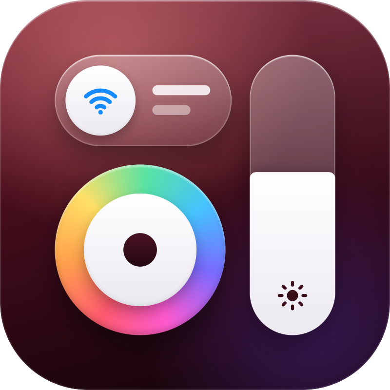
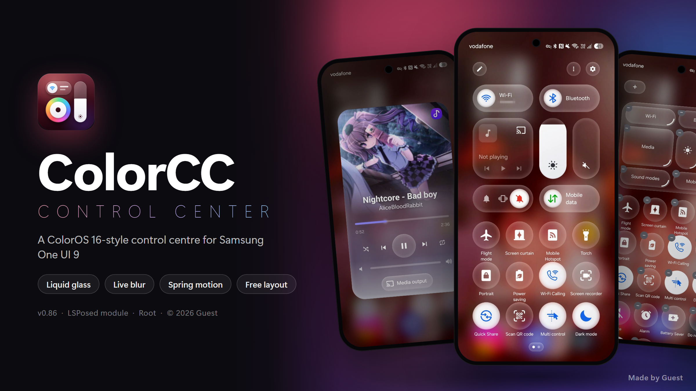
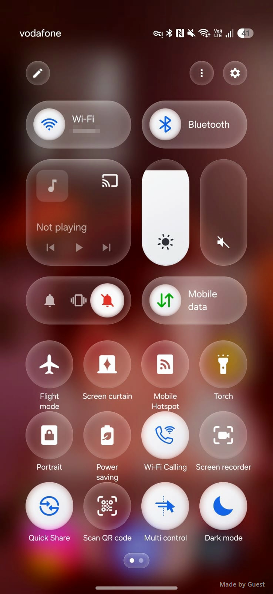
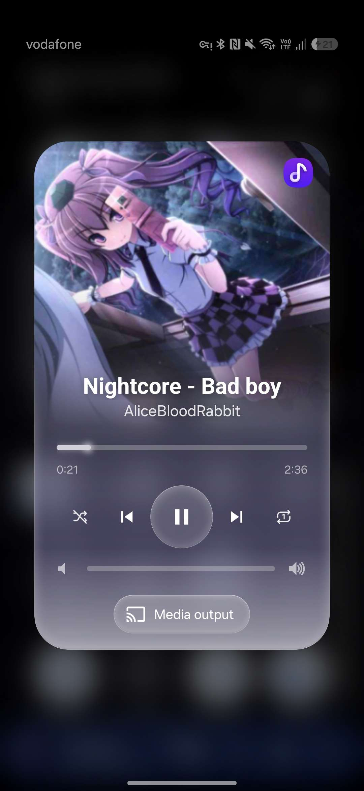
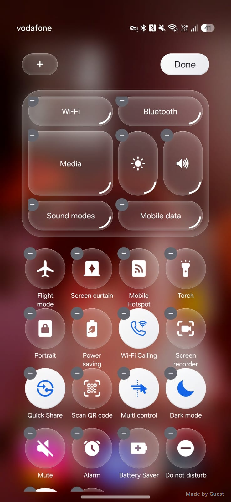

<div align="center">



# ColorCC

**A ColorOS-style control centre for Samsung One UI 9 and One UI 8.5**

Glass surfaces, a live blur and spring motion in place of One UI's quick panel, delivered as an LSPosed module.


<br><br>



</div>

<br>

## Overview

ColorCC replaces One UI's quick panel with a control centre modelled on ColorOS: large glass cards, tall sliders, round tiles and a full media player. Every surface is drawn over a live blur of whatever is behind the shade, and every element moves on springs that follow your finger.

ColorCC runs inside System UI as an LSPosed module. Nothing is changed on disk. Disable the module and the stock panel returns.

> This repository contains the APK and its documentation only.

<br>

## Screenshots

<table>
  <tr>
    <td align="center"></td>
    <td align="center"></td>
    <td align="center"></td>
  </tr>
  <tr>
    <td align="center"><b>Control centre</b></td>
    <td align="center"><b>Media player</b></td>
    <td align="center"><b>Editor</b></td>
  </tr>
</table>

<br>

## Features

### Glass
- **Four looks.** Liquid is clear glass that bends the background at its edge. Frosted is milky glass with a fine grain. Opaque is glossy black glass. None removes the glass effect for flat, see-through shapes.
- **Live blur** of what is behind the panel, so a playing video keeps moving through it. Choose Light, Normal or Strong.
- **Live reflections.** The glass on cards, tiles and sliders follows the screen behind it.
- **Tilt highlights.** The shine along each edge moves as you tilt the phone.

### Layout
- Wi-Fi, Bluetooth, mobile data, media, brightness, volume and sound-mode cards, followed by your tiles.
- **Move anything.** Hold an item and drag it. Tiles can also be placed among the cards, for example beside a slider or above the media card.
- **Resize cards and sliders** by dragging their corner. A slider made wide and short works sideways.
- **Two, three or four rows** of tiles per page.
- **Icon colours** in ColorOS's per-tile colours or in your system theme colour.
- Remove an item with **−** and add it back with **+**.

### Controls
- **Hold Wi-Fi or Bluetooth** for nearby networks or paired devices.
- **Hold the brightness slider** for a full-screen brightness view with auto brightness, dark mode and extra brightness.
- **Hold the volume slider** for media, ringtone, notification and system volume.
- **Hold the torch** to set its brightness.
- **Drag the brightness slider** and the rest of the panel fades, so you can judge the screen as it really looks.
- A VPN indicator in the header names the VPN app in use and opens VPN settings.
- The back button and back gesture close an open menu first, then the panel.

### Media player
- Tap the media card and it expands into a full player. The artwork fades into the glass, with the app's icon in the corner.
- The seek bar takes its colour from the album art.
- The app's own extra buttons, per-app volume and a media output switcher.

### Motion
- The opening follows your swipe. A slow pull eases in; a fast flick lands past its place and springs back.
- Swiping between the control centre and the notifications moves each element with your finger, one after another.
- Pull past the end and the panel stretches like rubber, then springs back.
- Menus grow out of the item you held and return into it when they close.

### Reliability
- Moving parts are drawn once and then only moved, so budget phones keep up.
- If something fails, the stock panel comes back. After three crashes, ColorCC turns itself off.

<br>

## Requirements

| | |
|---|---|
| **Phone** | Samsung Galaxy on **One UI 9** or **One UI 8.5**. Tablets and foldables unfolded keep the stock panel. |
| **Root** | Magisk or KernelSU |
| **Zygisk** | Zygisk or ReZygisk |
| **Framework** | LSPosed |

Other One UI versions are not supported. On them, ColorCC leaves the stock panel in place.

<br>

## Installation

1. Download **`ColorCC-v0.99.8.apk`** from the [Releases](../../releases) page and install it.
2. In **LSPosed > Modules**, enable **ColorCC** and select **System UI** in its scope.
3. Restart System UI, either by rebooting or by running this in a root terminal:
   ```sh
   su -c pkill -f com.android.systemui
   ```
4. Pull down the quick panel.

**To update,** install the new APK over the old one and restart System UI.

<br>

## Usage

| Action | Result |
|---|---|
| Tap a tile or card | Turns it on or off |
| Hold a tile or card | Opens its menu: networks, devices, torch brightness and more |
| Hold the brightness slider | Opens the brightness view |
| Hold the volume slider | Opens all volume levels |
| Tap the media card | Opens the full media player |
| Pencil, top left | Opens the editor |
| Power button, top right | Opens the power menu |
| Gear, top right | Opens Settings |

**In the editor,** hold and drag to move items, drag a corner to resize, and tap − or + to remove or add. Under Appearance, choose the glass look, the blur strength, the number of tile rows and the icon colours. The look and blur preview immediately. Tap **Done** to keep your changes, or the cross to discard them.

<br>

## Troubleshooting

<details>
<summary><b>The stock panel shows instead of ColorCC</b></summary>
<br>

- Check that ColorCC is enabled in LSPosed with **System UI** in its scope, then restart System UI.
- ColorCC runs only on One UI 9 and One UI 8.5 phones. Elsewhere it leaves the stock panel in place on purpose.
- After three crashes, ColorCC turns itself off. To turn it back on, run:
  ```sh
  su -c rm /data/user_de/0/com.android.systemui/files/colorcc_crashes
  ```
  Then restart System UI.
</details>

<details>
<summary><b>System UI keeps crashing or the screen is stuck</b></summary>
<br>

Uninstall the module from a root shell:

```sh
su -c "pm uninstall dev.colorcc"
```

Without a shell, boot into your root manager's safe mode (Magisk or KernelSU), which disables all modules.
</details>

<br>

## Reporting a bug

Contact **gtsw1** on Discord or **[@Guestoss](https://t.me/Guestoss)** on Telegram. Please include:

- the lines starting with `ColorCC:` from **LSPosed Manager > Logs**,
- your phone model and One UI version,
- a short screen recording, if you can.

<br>

## Uninstalling

Disable ColorCC in LSPosed or uninstall the app, then restart System UI. Nothing is left behind.

<br>

## Acknowledgements

Thanks to everyone who tested ColorCC and suggested features:

- **Alizabp**
- [**Namphet**](https://www.tiktok.com/@namphet_.s23)
- **希望**
- [**Kzrxe.7z**](https://www.tiktok.com/@nxt_nix2)
- **Kil**
- **Hayachi**
- **Hari**

<br>

## Disclaimer

ColorCC modifies System UI on a rooted phone. It is provided as is, without warranty, and you use it at your own risk. Before installing any System UI module, make sure you have a way back, such as your root manager's safe mode.

Samsung, Galaxy and One UI are trademarks of Samsung Electronics. ColorOS is a trademark of OPPO. ColorCC is an independent project and is not affiliated with or endorsed by either.

<br>

## Copyright

© 2026 Guest. All rights reserved.

ColorCC is free to download and use. Please share a link to this page rather than re-uploading the APK or images, and do not publish modified copies as your own.

<br>

<div align="center">

Made by **Guest** · © 2026 · Inspired by ColorOS and iOS

</div>
